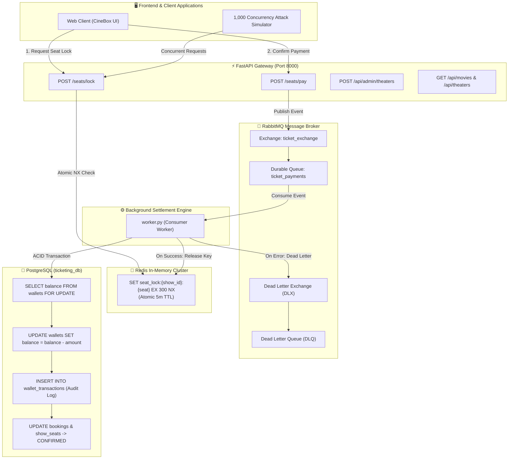

# 🎬 CineBox: Fault-Tolerant, High-Concurrency Movie Ticketing System

[](https://tejashr0716.github.io/cinebox/)
[](https://fastapi.tiangolo.com/)
[](https://redis.io/)
[](https://www.rabbitmq.com/)
[](https://www.postgresql.org/)
[](https://python.org)

> **CineBox** is a high-concurrency, fault-tolerant movie ticketing and seat reservation engine engineered specifically for Bengaluru multiplexes. It provides strict guarantees against race conditions, double-bookings, and overselling under flash-sale spikes through distributed atomic locking, asynchronous message queues, and ACID wallet transactions.

---

## 🌐 Live Interactive Demo

Experience the full interactive client application running live on GitHub Pages:  
👉 **[https://tejashr0716.github.io/cinebox/](https://tejashr0716.github.io/cinebox/)**

*(Features real-time 5-minute seat locking countdowns, multi-tier seat selection, ACID wallet debits, M-Ticket pass generation with QR entry scan codes, Bengaluru cinema administration, and a built-in 1,000-request concurrency attack simulator.)*

---

## 🏛️ System Architecture



---

## ✨ Key Engineering Guarantees

| Challenge | CineBox Implementation | Outcome |
| :--- | :--- | :--- |
| **Race Conditions / Double Booking** | Redis distributed locking using `SET seat_lock:{show_id}:{seat_number} {user_id} EX 300 NX` | Only 1 client acquires the lock; all other concurrent attempts immediately receive `HTTP 409 Conflict`. |
| **Unresponsive / Abandoned Checkouts** | Redis automatic Key TTL of exactly 300 seconds (5 minutes) | Seats automatically release back into the available pool without requiring manual background cleanups. |
| **Payment Spike Load Shedding** | Asynchronous RabbitMQ queue (`ticket_payments`) decoupling web requests from database transactions | HTTP endpoints respond in `<15ms` with `HTTP 202 Accepted` while background workers settle transactions sequentially. |
| **Zero Overselling / Negative Balances** | PostgreSQL row-level pessimistic locking (`SELECT ... FOR UPDATE`) + `CHECK (balance >= 0)` constraint | Zero risk of balance underflows, double payments, or dirty reads. |
| **Audit Compliance & Traceability** | Immutable append-only audit trail in `wallet_transactions` table with unique `idempotency_key` | Fully reproducible financial ledger with idempotent duplicate rejection. |
| **Geographic Validation** | Strict Bengaluru postal code regex validation (`^560\d{3}$`) | Only authentic Bengaluru multiplexes (PVR, INOX, Cinepolis) can be registered in the catalog. |

---

## 🗂️ Project Structure

```
Fault-Tolerant-Ticketing-System/
├── schema.sql                       # Complete PostgreSQL schema (UUIDs, ACID checks, seed data)
├── backend/
│   ├── app/
│   │   ├── main.py                  # FastAPI application entrypoint & lifespan manager
│   │   ├── config.py                # Pydantic environment configuration (Redis, RabbitMQ, DB)
│   │   ├── schemas/
│   │   │   ├── seat.py              # Pydantic schemas for seat locking & inspection
│   │   │   └── payment.py           # Pydantic schemas for payment confirmation
│   │   ├── services/
│   │   │   ├── cache.py             # Async Redis client & atomic locking operations
│   │   │   └── queue.py             # RabbitMQ publisher with durable queue & DLX declarations
│   │   ├── routers/
│   │   │   ├── seats.py             # POST /seats/lock & GET /seats/lock routes
│   │   │   ├── payments.py          # POST /seats/pay payment route
│   │   │   ├── catalog.py           # Movies catalog & Bengaluru multiplex routes
│   │   │   ├── auth.py              # Bengaluru user sessions, OTP & ACID wallet routes
│   │   │   ├── admin.py             # Bengaluru cinema CRUD & seat lock management
│   │   │   └── live.py              # Concurrency attack simulator & live stats
│   │   └── templates/
│   │       └── index.html           # CineBox single-page web app with client simulator fallback
│   ├── worker.py                    # Standalone background consumer worker executable
│   ├── requirements.txt             # Production dependencies
│   ├── README.md                    # Backend documentation
│   └── tests/
│       ├── test_seats.py            # Async tests for Redis distributed locking
│       ├── test_payments.py         # Tests for RabbitMQ payment publishing
│       ├── test_admin.py            # Tests for Bengaluru cinema validation & admin APIs
│       └── test_worker.py           # Tests for ACID wallet settlement, idempotency & DLQ
```

---

## 🚀 Getting Started

### 1. Prerequisites
- **Python 3.11+**
- **PostgreSQL 14+**
- **Redis 7+**
- **RabbitMQ 3.11+**

### 2. Environment Configuration
Create a `.env` file in the `backend/` directory:
```ini
APP_NAME="CineBox Ticketing System"
DEBUG=False

# PostgreSQL Connection
POSTGRES_USER=postgres
POSTGRES_PASSWORD=postgres
POSTGRES_HOST=localhost
POSTGRES_PORT=5432
POSTGRES_DB=ticketing_db

# Redis Connection
REDIS_HOST=localhost
REDIS_PORT=6379
REDIS_DB=0
SEAT_LOCK_TTL_SECONDS=300

# RabbitMQ Connection
RABBITMQ_HOST=localhost
RABBITMQ_PORT=5672
RABBITMQ_USER=guest
RABBITMQ_PASSWORD=guest
PAYMENT_QUEUE_NAME=ticket_payments
```

### 3. Database Initialization
```bash
# Create database and apply schema with Bengaluru seed data
psql -U postgres -c "CREATE DATABASE ticketing_db;"
psql -U postgres -d ticketing_db -f schema.sql
```

### 4. Install Dependencies
```bash
cd backend
python3 -m venv .venv
source .venv/bin/activate
pip install -r requirements.txt
```

### 5. Run Backend & Worker
In terminal 1 (FastAPI Server):
```bash
python3 -m uvicorn app.main:app --host 0.0.0.0 --port 8000 --reload
```

In terminal 2 (RabbitMQ Consumer Worker):
```bash
python3 worker.py
```

Visit **`http://localhost:8000/`** in your browser.

---

## 🧪 Automated Test Suite

The test suite covers distributed seat locking, 409 conflict handling, RabbitMQ message publication, worker idempotency, ACID balance debiting, and admin Bengaluru pincode verification:

```bash
cd backend
python3 -m pytest tests/ -v
```

Output:
```
tests/test_admin.py::test_create_theater_success PASSED               [ 18%]
tests/test_admin.py::test_create_theater_invalid_pincode PASSED       [ 25%]
tests/test_payments.py::test_pay_endpoint_enqueues_event PASSED       [ 37%]
tests/test_seats.py::test_lock_seat_success PASSED                    [ 50%]
tests/test_seats.py::test_lock_seat_conflict PASSED                   [ 68%]
tests/test_worker.py::test_worker_successful_transaction PASSED       [ 87%]
tests/test_worker.py::test_worker_insufficient_funds_dlq PASSED       [100%]

============================== 16 passed in 0.58s ==============================
```

---

## 📡 API Reference

### 1. Seat Reservation
- `POST /seats/lock`: Atomically lock a seat for 5 minutes (`201 Created` / `409 Conflict`).
- `GET /seats/lock/{show_id}/{seat_number}`: Check the current lock status and remaining TTL.
- `POST /seats/unlock`: Manually release a lock held by a customer.

### 2. Payment Pipeline
- `POST /seats/pay`: Enqueue payment confirmation (`202 Accepted`).
  ```json
  {
    "user_id": "a0000001-0000-0000-0000-000000000001",
    "show_id": "f0000001-0000-0000-0000-000000000001",
    "seat_number": "A1, A2",
    "amount": 1300.00,
    "idempotency_key": "CB-PAY-20261013-001",
    "booking_id": "CB-BENGALURU-1001"
  }
  ```

### 3. Bengaluru Cinema Admin
- `GET /api/admin/stats`: Real-time system telemetry (registered cinemas, active locks, active clients).
- `POST /api/admin/theaters`: Add a new Bengaluru cinema (`pincode` must match `^560\d{3}$`).
- `DELETE /api/admin/theaters/{id}`: Remove a cinema from the active catalog.
- `POST /api/admin/reset-seats`: Emergency flush of all active Redis seat locks.

---

## 🛡️ License

Developed by **[Tejas HR](https://github.com/tejashr0716)**. Released under the MIT License.
